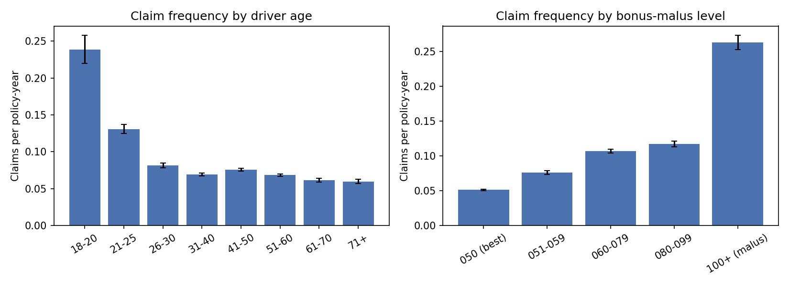
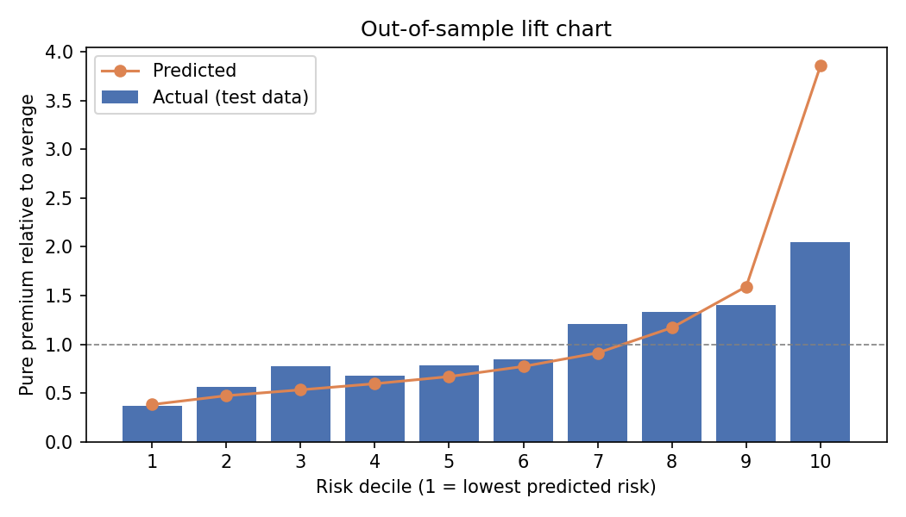

# Motor Insurance Pricing Analysis in SQL

An end-to-end pricing analysis of **677,991 real motor insurance policies and 26,444 claims**, written in SQL. It runs from raw data to tested rating relativities: data quality checks, claim frequency and severity by rating factor, large-loss capping, credibility-weighted relativities and an out-of-sample lift test.

**Tools:** SQL (DuckDB) · Python (runner and charts only)

---

## Data

The data is **freMTPL2**, a French motor third-party liability portfolio from the R package [CASdatasets](https://github.com/dutangc/CASdatasets). It is a standard dataset in actuarial pricing research.

| Table | Rows | Contents |
|---|---|---|
| `freMTPL2freq` | 677,991 | One row per policy: exposure (years), claim count, driver age, bonus-malus level, vehicle age, power, brand, fuel, area, density, region |
| `freMTPL2sev` | 26,444 | One row per claim: policy ID and claim amount (EUR) |

---

## What each script does

| Script | Purpose | SQL techniques |
|---|---|---|
| `01_create_tables.sql` | Loads raw files; caps exposure at 1 year; bands rating factors; makes an 80/20 train/test split; caps claims at the 99.5th percentile; builds one row per policy with claims summed | `CASE` banding, `hash()` split, `LEFT JOIN` + `GROUP BY ALL`, `ROW_NUMBER()` |
| `02_data_quality.sql` | Ten reconciliation checks with PASS/REVIEW status; control totals showing the clean tables add back to the raw files | Correlated subqueries, `EXISTS` / `NOT EXISTS`, `UNION ALL` |
| `03_portfolio_summary.sql` | Portfolio frequency, severity and pure premium; region ranking with each region's share of exposure and of claims | Window functions: `SUM() OVER ()`, `RANK()` |
| `04_one_way_analysis.sql` | Frequency, severity and pure premium for every level of every rating factor, with 95% confidence intervals | `UNPIVOT` (one query for all factors), CTEs |
| `05_large_losses.sql` | Claim size distribution; cap, excess and large-loss load; ten largest claims | `QUANTILE_CONT`, `FILTER`, `QUALIFY` |
| `06_credibility_relativities.sql` | Relativities on training data, blended with limited-fluctuation credibility; multiplicative risk score for every policy | Self-joins to a lookup table, CTE chain |
| `07_out_of_sample_lift.sql` | Exposure-weighted deciles, lift and Gini on the 20% test sample | Running `SUM() OVER (ORDER BY …)`, named `WINDOW`, `LAG()`, trapezium rule in SQL |

---

## Key findings

**Portfolio.** Claim frequency is 7.4% per policy-year, average claim cost is €2,265 and the pure premium is €167 per policy-year.

**Data quality.** All claims match a policy, and claim counts match claim records exactly. There are two issues:
- 1,224 policies have exposure above one year. These are capped at 1.
- 8 policies report 5–16 claims in a year. These are treated as data errors and excluded.

**Large losses drive cost.** Claims above €20,000 are 0.8% of claims but 37% of the total amount. The single largest claim is €4.1m. Capping at the 99.5th percentile (€34,377) removes 25% of incurred cost, which is added back as a flat load of 1.34.



**Rating factors.**
- **Driver age:** drivers aged 18–20 claim 3.2 times as often as the portfolio average. The risk falls steeply to age 30, then flattens.
- **Bonus-malus:** policies at 100+ (malus) claim 3.6 times the average frequency. Policies at the best level (50) claim at 0.7 times.
- **Area:** frequency rises steadily from area A (rural, 0.74) to E (urban, 1.30).
- **Credibility:** the 18–20 age band has only 509 training claims, so its observed pure-premium relativity of 4.96 gets credibility 0.69 and is pulled down to 3.71.



**Out-of-sample test.** On the 20% of policies the relativities never saw:

| Metric | Result |
|---|---|
| Gini | 0.26 |
| Lift (worst decile ÷ best decile) | 5.6 |
| Correlation of predicted vs actual, by decile | 0.91 |

The score ranks risk well, but it **over-predicts the riskiest decile** (3.9 predicted vs 2.1 actual). This happens because one-way relativities are multiplied together as if the factors were independent. They are not: young drivers also tend to have high bonus-malus levels, so that risk is counted twice. The fix is a **Poisson/Gamma GLM**, which estimates each factor's effect while holding the others constant. That is the natural next step for this project.

---

## How to run

```bash
pip install duckdb pyreadr matplotlib
python get_data.py    # downloads the data into data/
python run_all.py     # runs sql/01 … 07, writes results/*.csv and charts/*.png
```

You can also run the scripts directly in the DuckDB CLI, in order:

```bash
duckdb motor.duckdb < sql/01_create_tables.sql
```

The SQL is close to PostgreSQL/ANSI. The DuckDB-specific parts are `UNPIVOT`, `QUALIFY`, `GROUP BY ALL` and `hash()`. Each has a standard equivalent: `UNION ALL`, a subquery on a window function, an explicit column list, and a modulo on the ID.
